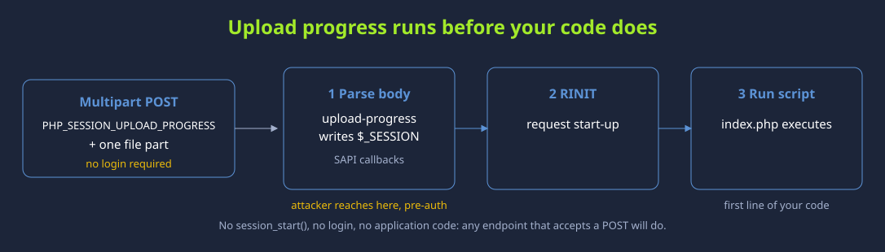
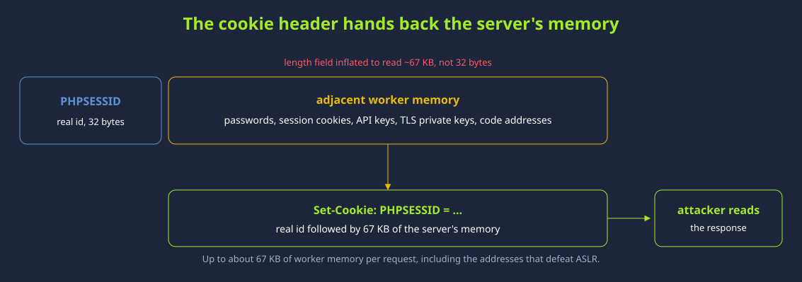
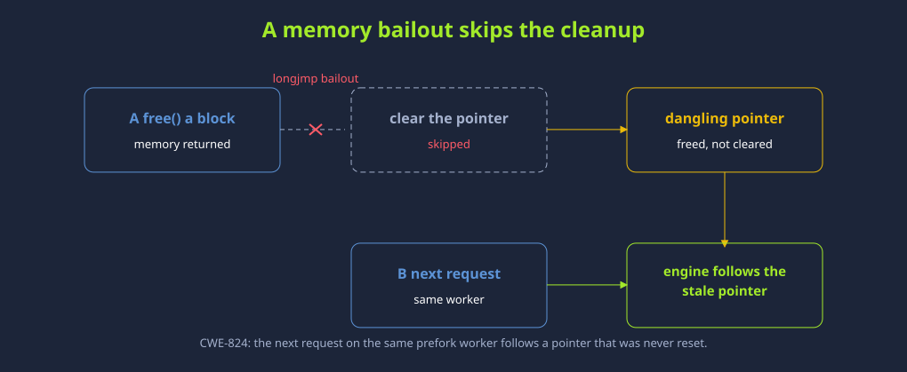
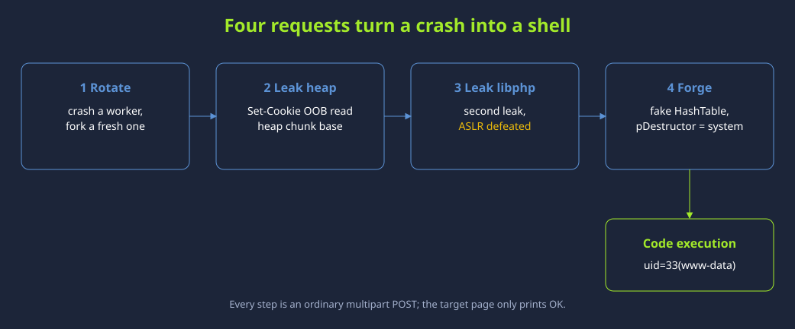

# PHP2Shell — Dua CVE PHP, 21 Oktober 2026

> Catatan belajar TryHackMe. Seluruh pengujian eksploitasi hanya dilakukan pada lab yang memang diizinkan.

## Ringkasan

Pada 21 Oktober 2026, proyek PHP merilis pembaruan darurat untuk dua kerentanan kritis yang dapat memungkinkan remote code execution tanpa autentikasi pada kondisi terdampak: **CVE-2026-109618** dan **CVE-2026-109619**. Keduanya berakar pada pengelolaan memori dan penanganan error di PHP. PHP memperingatkan bahwa mitigasi konfigurasi hanya mengurangi jalur tertentu; pembaruan versi tetap perbaikan lengkap.

TryHackMe menjelaskan bahwa penggunaan `session.upload_progress` adalah salah satu jalur riset yang beredar, bukan akar tunggal kedua CVE. Mematikannya saja tidak melindungi dari kedua kerentanan.

## Dua Kerentanan

### CVE-2026-109618 — korupsi memori saat out-of-memory

Saat PHP mengalami kondisi kehabisan memori, proses request dapat dihentikan ketika sebagian state internal belum selesai diinisialisasi. Jalur cleanup kemudian dapat membaca atau memperlakukan state yang belum valid sebagai data siap pakai. Advisory PHP menyebut beberapa kondisi request multipart dapat mencapai jalur ini; dampaknya yang didemonstrasikan mencakup RCE, termasuk pada Apache `mod_php` sebelum kode aplikasi berjalan.

### CVE-2026-109619 — state lama setelah memori dilepas

State internal yang seharusnya hanya hidup selama satu request dapat tertinggal setelah memori request dilepas. Request berikutnya pada worker yang sama berpotensi memakai referensi usang (*use-after-free*). Jalur session-related melibatkan upload progress, tetapi advisori juga membahas variasi jalur lain.

## Diagram Riset

Gambar-gambar ini menggambarkan jalur dan tahapan riset PHP2Shell yang ada di folder ini. Anggap sebagai ilustrasi alur eksploitasi pada target/lab tertentu, bukan gambaran lengkap setiap konfigurasi PHP atau bukti bahwa satu gambar hanya mewakili satu CVE.

### Upload progress diproses sebelum kode aplikasi

### Kebocoran memori dan informasi yang dapat membantu melewati ASLR

### Referensi ke memori yang sudah dilepas

### Rangkaian tahap menuju eksekusi kode pada demo

## Perbaikan dan Mitigasi

Versi upstream yang memperbaiki kedua CVE:

- PHP 8.5.12
- PHP 8.4.27
- PHP 8.3.36
- PHP 8.2.35

Paket distro dan vendor LTS dapat memakai nomor versi berbeda karena patch dapat di-backport; periksa advisory vendor untuk paket yang benar. PHP 8.1 dan versi lebih lama tidak memperoleh rilis keamanan standar dari proyek PHP, sehingga cek dukungan vendor atau rencanakan upgrade.

Jika pembaruan belum dapat dipasang, panduan PHP memuat langkah sementara yang membatasi jalur tertentu, termasuk pengaturan `session.upload_progress.enabled=0` untuk jalur yang telah dikonfirmasi pada CVE-2026-109619. Itu bukan perbaikan lengkap dan cara penerapan konfigurasi penting. Ikuti advisory PHP untuk konfigurasi server yang tepat; jangan menganggap satu perubahan tersebut membuat sistem aman.

## Cara Membaca Diagram

- `session_upload.svg`: menunjukkan mengapa parsing upload dapat terjadi sebelum baris pertama kode aplikasi.
- `breach_memory.svg`: menggambarkan kebocoran data dari memori worker dan kemungkinan informasi alamat proses ikut terpapar.
- `jmp.svg`: menggambarkan pointer yang tidak dibersihkan setelah alur bailout, lalu dipakai lagi.
- `breach_shell.svg`: merangkum urutan demonstrasi pada lab—rotasi worker, kebocoran, pemetaan alamat, lalu tahap forge/eksekusi.

## Sumber

- [TryHackMe — The PHP Patch Is Out. The Bug Wasn’t Where Anyone Thought](https://tryhackme.com/resources/blog/php2shell-patch)
- [PHP News Archive — Security advisory, 21 October 2026](https://www.php.net/archive/2026.php)
- [PHP Advisory — CVE-2026-109618 (OOM corruption)](https://github.com/php/php-src/security/advisories/GHSA-w8hw-w9fx-j79w)
- [PHP Advisory — CVE-2026-109619 (stale global state)](https://github.com/php/php-src/security/advisories/GHSA-6wmf-4rv5-p3rp)
