# LB-Graph-Overview — Grafik Overview Laptop Battlefield

> Mermaid diagram + wikilink list untuk Obsidian Graph View.

---

## Mermaid Diagram

```mermaid
graph TD
    %% Hub
    Hub[Home-Laptop-Battlefield]

    %% System cluster
    Sys[System Notes]
    HW[LB-Hardware]
    OS[LB-Operating-System]
    ST[LB-Storage]
    NW[LB-Network]
    TC[LB-Development-Toolchain]
    AI[LB-AI-Agents]

    %% Project cluster
    Proj[Project Notes]
    M1[LB-Project-Monitoring-Laravel-1]
    M2[LB-Project-Monitoring-Laravel-Prototype]
    WM[LB-Project-Web-Monitor]
    GNS[LB-Project-GNS3-Labs]
    MS[LB-Project-Masjidku-WordPress]

    %% Timeline cluster
    Time[Timeline & Incident]
    WL[LB-Work-Log]
    IF[LB-Incident-Freeze-RAM-USB-SSD]
    IS[LB-Incident-SQLite-Driver-Missing]

    %% Handoff cluster
    Hand[Handoff & Graph]
    AH[LB-AI-Handoff]
    RP[LB-Refresh-Playbook]
    OQ[LB-Open-Questions]
    GO[LB-Graph-Overview]
    GD[LB-Graph-Service-Dependencies]
    GT[LB-Graph-Project-Toolchain]

    %% Entity cluster
    Ent[Entity Notes]
    TD[LB-Tool-Docker]
    TCG[LB-Tool-CodeGraph]
    TH[LB-Tool-Hermes]
    TO[LB-Tool-Obsidian]
    SPG[LB-Service-PostgreSQL]
    SMA[LB-Service-MariaDB]
    SZ[LB-Service-Zabbix]
    SRO[LB-Service-RouterOS]
    PMCC[LB-Project-MCC]

    %% Vault Existing
    Vault[Vault Existing Notes]
    SPH[Spek HP Pavilion g4]
    HRS[Hardware Repair SATA dan Repasting]
    DFR[Diagnosis Freeze RAM dan USB SSD]
    CIH[Constraint Intel HD 4000]
    PBW[Project Baru - Web Integrasi MikroTik RADIUS Zabbix]
    LKH[Log Kerja Hermes - web-monitor]
    DIW[Dokumentasi Instalasi web-monitor]

    %% Connections
    Hub --> Sys
    Hub --> Proj
    Hub --> Time
    Hub --> Hand
    Hub --> Ent
    Hub --> Vault

    Sys --> HW
    Sys --> OS
    Sys --> ST
    Sys --> NW
    Sys --> TC
    Sys --> AI

    Proj --> M1
    Proj --> M2
    Proj --> WM
    Proj --> GNS
    Proj --> MS

    Time --> WL
    Time --> IF
    Time --> IS

    Hand --> AH
    Hand --> RP
    Hand --> OQ
    Hand --> GO
    Hand --> GD
    Hand --> GT

    Ent --> TD
    Ent --> TCG
    Ent --> TH
    Ent --> TO
    Ent --> SPG
    Ent --> SMA
    Ent --> SZ
    Ent --> SRO
    Ent --> PMCC

    Vault --> SPH
    Vault --> HRS
    Vault --> DFR
    Vault --> CIH
    Vault --> PBW
    Vault --> LKH
    Vault --> DIW

    %% Cross-links
    HW -.-> HRS
    HW -.-> SPH
    HW -.-> CIH
    IF -.-> DFR
    ST -.-> HW
    ST -.-> HRS
    OS -.-> SPH
    M1 -.-> M2
    M2 -.-> PBW
    WM -.-> PBW
    WM -.-> LKH
    WM -.-> DIW
    WM -.-> IS
    GNS -.-> SRO
    M1 -.-> PMCC
    M2 -.-> PMCC
    AI -.-> TH
    AI -.-> TCG
    TC -.-> TD
    NW -.-> TD
    NW -.-> SPG
    NW -.-> SMA
    NW -.-> SZ
```

---

## Wikilink List (untuk Graph View parsing)

### Hub
- [[Home-Laptop-Battlefield]]

### System
- [[LB-Hardware]]
- [[LB-Operating-System]]
- [[LB-Storage]]
- [[LB-Network]]
- [[LB-Development-Toolchain]]
- [[LB-AI-Agents]]

### Projects
- [[LB-Project-Monitoring-Laravel-1]]
- [[LB-Project-Monitoring-Laravel-Prototype]]
- [[LB-Project-Web-Monitor]]
- [[LB-Project-GNS3-Labs]]
- [[LB-Project-Masjidku-WordPress]]

### Timeline & Incident
- [[LB-Work-Log]]
- [[LB-Incident-Freeze-RAM-USB-SSD]]
- [[LB-Incident-SQLite-Driver-Missing]]

### Handoff & Graph
- [[LB-AI-Handoff]]
- [[LB-Refresh-Playbook]]
- [[LB-Open-Questions]]
- [[LB-Graph-Overview]]
- [[LB-Graph-Service-Dependencies]]
- [[LB-Graph-Project-Toolchain]]

### Entity Notes
- [[LB-Tool-Docker]]
- [[LB-Tool-CodeGraph]]
- [[LB-Tool-Hermes]]
- [[LB-Tool-Obsidian]]
- [[LB-Service-PostgreSQL]]
- [[LB-Service-MariaDB]]
- [[LB-Service-Zabbix]]
- [[LB-Service-RouterOS]]
- [[LB-Project-MCC]]

### Vault Existing (Cross-links)
- [[Spek HP Pavilion g4]]
- [[Hardware Repair SATA dan Repasting]]
- [[Diagnosis Freeze RAM dan USB SSD]]
- [[Constraint Intel HD 4000]]
- [[Project Baru - Web Integrasi MikroTik RADIUS Zabbix]]
- [[Log Kerja Hermes - web-monitor]]
- [[Dokumentasi Instalasi web-monitor]]

---

## Graph View Filter Groups (Saran)

Buat di Obsidian Settings → Graph View → Groups:

| Group Name | Query | Color | Description |
|------------|-------|-------|-------------|
| System | path:Laptop-Battlefield/System | #3B82F6 | Blue - system notes |
| Projects | path:Laptop-Battlefield/Projects | #10B981 | Green - project notes |
| Timeline | path:Laptop-Battlefield/Timeline OR path:Laptop-Battlefield/Incidents | #F59E0B | Amber - timeline |
| Handoff | path:Laptop-Battlefield/LB-AI-Handoff OR path:Laptop-Battlefield/LB-Refresh-Playbook OR path:Laptop-Battlefield/LB-Open-Questions | #8B5CF6 | Purple - handoff |
| Graphs | path:Laptop-Battlefield/Graphs | #EC4899 | Pink - graph notes |
| Entities | path:Laptop-Battlefield/LB-Tool-* OR path:Laptop-Battlefield/LB-Service-* OR path:Laptop-Battlefield/LB-Project-MCC | #6366F1 | Indigo - entity |
| Vault Existing | path:MikroTik OR path:Linux OR path:Cybersecurity | #64748B | Slate - existing vault |

---

#laptop-battlefield #graph #overview
[[Home-Laptop-Battlefield]]