# LB-Graph-Project-Toolchain — Proyek ↔ Tools/Services

> Mermaid diagram + wikilink list untuk project-toolchain mapping di Graph View.

---

## Mermaid Diagram

```mermaid
graph TD
    %% Projects
    M1[LB-Project-Monitoring-Laravel-1]
    M2[LB-Project-Monitoring-Laravel-Prototype]
    WM[LB-Project-Web-Monitor]
    GNS[LB-Project-GNS3-Labs]
    MS[LB-Project-Masjidku-WordPress]

    %% Tools
    GIT[Git 2.56]
    GCC[GCC 16.2]
    PY[Python 3.14]
    NODE[Node 20.20]
    PHP[PHP 8.5]
    COMP[Composer 2.10]
    DOCKER[LB-Tool-Docker]
    CG[LB-Tool-CodeGraph]
    HERMES[LB-Tool-Hermes]
    OBS[LB-Tool-Obsidian]

    %% Editors
    HX[helix]
    NVIM[nvim]
    CURSOR[Cursor]
    CLAUDE[Claude Desktop]

    %% Databases
    PG[LB-Service-PostgreSQL]
    MARIA[LB-Service-MariaDB]
    SQLITE[sqlite3]
    REDIS[redis-cli]

    %% AI Agents
    CODEX[Codex]
    OPN[opencode]

    %% Virtualization
    QEMU[qemu-system-x86_64]

    %% Project → Toolchain
    M1 --> PHP
    M1 --> COMP
    M1 --> DOCKER
    M1 --> MARIA
    M1 --> GIT
    M1 --> CG
    M1 --> HERMES
    M1 --> CURSOR
    M1 --> CLAUDE

    M2 --> PHP
    M2 --> COMP
    M2 --> DOCKER
    M2 --> PG
    M2 --> NODE
    M2 --> GIT
    M2 --> CG
    M2 --> HERMES
    M2 --> CURSOR
    M2 --> CLAUDE
    M2 --> HX

    WM --> PHP
    WM --> COMP
    WM --> DOCKER
    WM --> PG
    WM --> GIT
    WM --> CLAUDE
    WM --> HERMES

    GNS --> QEMU
    GNS --> DOCKER
    GNS --> GIT

    MS --> DOCKER
    MS --> GIT
    MS --> CURSOR

    %% Toolchain internal
    DOCKER --> PG
    DOCKER --> MARIA
    DOCKER --> SQLITE
    CG --> GIT
    HERMES --> CLAUDE
    HERMES --> CODEX
    HERMES --> OPN
    HERMES --> CURSOR
    OPN --> CG
```

---

## Wikilink List

### Projects
- [[LB-Project-Monitoring-Laravel-1]]
- [[LB-Project-Monitoring-Laravel-Prototype]]
- [[LB-Project-Web-Monitor]]
- [[LB-Project-GNS3-Labs]]
- [[LB-Project-Masjidku-WordPress]]

### Tools
- [[LB-Tool-Docker]]
- [[LB-Tool-CodeGraph]]
- [[LB-Tool-Hermes]]
- [[LB-Tool-Obsidian]]

### Services
- [[LB-Service-PostgreSQL]]
- [[LB-Service-MariaDB]]

### AI Agents (referensi)
- [[LB-AI-Agents]] (detail di System)

---

## Project × Toolchain Matrix

| Project | PHP | Composer | Node | Docker | PostgreSQL | MariaDB | CodeGraph | Hermes | Git | Editor |
|---------|-----|----------|------|--------|------------|---------|-----------|--------|-----|--------|
| monitoring-laravel-1 | ✅ | ✅ | ❌ | ✅ | ❌ | ✅ | ✅ | ✅ | ✅ | Cursor, Claude |
| monitoring-laravel-prototype | ✅ | ✅ | ✅ | ✅ | ✅ | ❌ | ✅ | ✅ | ✅ | Cursor, Claude, helix |
| web-monitor (historical) | ✅ | ✅ | ❌ | ✅ | ✅ | ❌ | ❌ | ✅ | ✅ | Claude |
| GNS3 Labs | ❌ | ❌ | ❌ | ✅ | ❌ | ❌ | ❌ | ❌ | ✅ | - |
| Masjidku WP | ❌ | ❌ | ❌ | ✅ | ❌ | ❌ | ❌ | ❌ | ✅ | Cursor |

---

## Graph View Filter (Saran)

| Group | Query | Color |
|-------|-------|-------|
| Laravel Projects | path:Laptop-Battlefield/Projects/LB-Project-Monitoring* | #3B82F6 |
| Toolchain Core | path:Laptop-Battlefield/LB-Tool-* | #10B981 |
| AI Agents | path:Laptop-Battlefield/System/LB-AI-Agents | #F59E0B |
| Database Services | path:Laptop-Battlefield/LB-Service-* | #8B5CF6 |
| Other Projects | path:Laptop-Battlefield/Projects/LB-Project-GNS3-Labs OR path:Laptop-Battlefield/Projects/LB-Project-Masjidku-WordPress | #6366F1 |

---

#laptop-battlefield #graph #project-toolchain
[[Home-Laptop-Battlefield]]