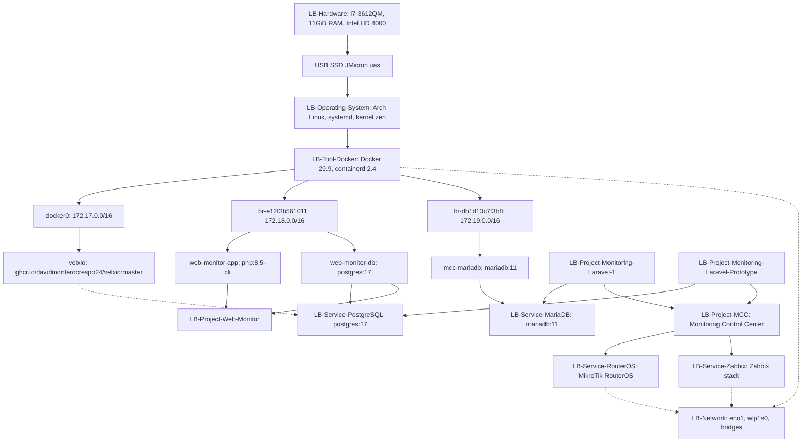

# LB-Graph-Service-Dependencies — Docker, Database, Laravel, Monitoring Stack

> Mermaid diagram + wikilink list untuk service dependencies di Graph View.

---

## Mermaid Diagram

---

## Wikilink List

### Infrastructure
- [[LB-Hardware]]
- [[LB-Operating-System]]
- [[LB-Tool-Docker]]
- [[LB-Network]]

### Docker Networks & Containers
- [[LB-Service-PostgreSQL]]
- [[LB-Service-MariaDB]]
- [[LB-Service-Zabbix]]

### Projects
- [[LB-Project-Monitoring-Laravel-1]]
- [[LB-Project-Monitoring-Laravel-Prototype]]
- [[LB-Project-Web-Monitor]]
- [[LB-Project-MCC]]

### External Services
- [[LB-Service-RouterOS]]
- [[LB-Project-GNS3-Labs]] (simulasi RouterOS)
- [[LB-Project-Masjidku-WordPress]] (cPanel hosting)

---

## Service Dependency Matrix

| Service | Depends On | Used By | Status |
|---------|------------|---------|--------|
| Docker Engine | OS, USB SSD | All containers | ✅ Running |
| docker0 bridge | Docker | velxio | ✅ UP |
| br-e12f3b561011 | Docker | web-monitor (app+db) | 🔴 DOWN |
| br-db1d13c7f3b8 | Docker | mcc-mariadb | 🔴 DOWN |
| PostgreSQL (PG) | docker0/br1 | web-monitor, MCC-prototype | Container exited |
| MariaDB | docker0/br2 | MCC-1 | Container exited |
| Zabbix | br2 (planned) | Monitoring stack | Not deployed |
| RouterOS | Network | MCC polling | Target device |
| velxio | docker0 | Unknown (7.13GB image) | ✅ Running |

---

## Graph View Filter (Saran)

| Group | Query | Color |
|-------|-------|-------|
| Infrastructure | path:Laptop-Battlefield/System OR path:Laptop-Battlefield/LB-Tool-Docker OR path:Laptop-Battlefield/LB-Network | #3B82F6 |
| Databases | path:Laptop-Battlefield/LB-Service-PostgreSQL OR path:Laptop-Battlefield/LB-Service-MariaDB | #10B981 |
| Monitoring Stack | path:Laptop-Battlefield/Projects/LB-Project-Monitoring* OR path:Laptop-Battlefield/LB-Project-MCC OR path:Laptop-Battlefield/LB-Service-RouterOS OR path:Laptop-Battlefield/LB-Service-Zabbix | #F59E0B |
| External | path:Laptop-Battlefield/LB-Project-Masjidku-WordPress OR path:Laptop-Battlefield/LB-Project-GNS3-Labs | #8B5CF6 |

---

#laptop-battlefield #graph #service-dependencies
[[Home-Laptop-Battlefield]]