# Laptop Battlefield — Peta Recon Mesin Ini

> Hub utama untuk catatan recon laptop HP Pavilion g4 (sistem utama saat ini). Semua note di bawah folder `Laptop-Battlefield/` terhubung ke sini.

---

## 🖥️ Sistem (System)

- [[LB-Hardware]] — Spesifikasi terverifikasi, keterbatasan GPU/USB-SSD
- [[LB-Operating-System]] — Arch Linux systemd, kernel zen, Hyprland Wayland
- [[LB-Storage]] — Layout blok, mount, zram, enclosure USB JMicron
- [[LB-Network]] — Interface, bridge Docker, socket listening, VPN tools
- [[LB-Development-Toolchain]] — Git, compiler, Python/Node/PHP, Docker, DB, editor
- [[LB-AI-Agents]] — Hermes, Claude, Cursor, opencode/CodeGraph, Codex

---

## 📦 Proyek (Projects)

- [[LB-Project-Monitoring-Laravel-1]] — M1 auth/role + CRUD Device, branch main
- [[LB-Project-Monitoring-Laravel-Prototype]] — DeviceLatestPoll, Livewire panel, dashboard, test
- [[LB-Project-Web-Monitor]] — Laravel 13 + Filament + PostgreSQL (hanya history)
- [[LB-Project-GNS3-Labs]] — Project simulasi routing OSPF (file .gns3 baru diubah)
- [[LB-Project-Masjidku-WordPress]] — 127 subdomain, cPanel kenari.superserver.co.id

---

## 📅 Timeline & Insiden

- [[LB-Work-Log]] — Log kerja kronologis per tanggal/proyek
- [[LB-Incident-Freeze-RAM-USB-SSD]] — OOM killer berulang, earlyoom fix, scheduler todo
- [[LB-Incident-SQLite-Driver-Missing]] — PHP Arch shared extension fix

---

## 🤝 Handoff & Grafik

- [[LB-AI-Handoff]] — Orientasi singkat untuk sesi AI depan
- [[LB-Refresh-Playbook]] — Perintah read-only yang dipakai recon
- [[LB-Open-Questions]] — Pertanyaan terbuka dari recon + vault
- [[LB-Graph-Overview]] — Mermaid + wikilink overview
- [[LB-Graph-Service-Dependencies]] — Docker, DB, Laravel, monitoring stack
- [[LB-Graph-Project-Toolchain]] — Proyek ↔ tools/services

---

## 🔧 Entity Notes (Tools/Services)

- [[LB-Tool-Docker]]
- [[LB-Tool-CodeGraph]]
- [[LB-Tool-Hermes]]
- [[LB-Tool-Obsidian]]
- [[LB-Service-PostgreSQL]]
- [[LB-Service-MariaDB]]
- [[LB-Service-Zabbix]]
- [[LB-Service-RouterOS]]
- [[LB-Project-MCC]]

---

## Terhubung ke Vault Existing

- [[Spek HP Pavilion g4]] — Spesifikasi lama (Artix/OpenRC, perlu update)
- [[Hardware Repair SATA dan Repasting]] — Kabel SATA putus → USB enclosure
- [[Diagnosis Freeze RAM dan USB SSD]] — Insiden freeze & fix earlyoom
- [[Constraint Intel HD 4000]] — Keterbatasan GPU
- [[Project Baru - Web Integrasi MikroTik RADIUS Zabbix]] — Project PKL monitoring
- [[Log Kerja Hermes - web-monitor]] — Log setup web-monitor
- [[Dokumentasi Instalasi web-monitor]] — Dokumentasi detail instalasi

---

## Grafik Overview (Mermaid + Wikilink)

```mermaid
graph TD
    Hub[Home-Laptop-Battlefield] --> Sys[System Notes]
    Hub --> Proj[Project Notes]
    Hub --> Time[Timeline & Incident]
    Hub --> Hand[Handoff & Graph]
    Hub --> Ent[Entity Notes]

    Sys --> HW[LB-Hardware]
    Sys --> OS[LB-Operating-System]
    Sys --> ST[LB-Storage]
    Sys --> NW[LB-Network]
    Sys --> TC[LB-Development-Toolchain]
    Sys --> AI[LB-AI-Agents]

    Proj --> M1[LB-Project-Monitoring-Laravel-1]
    Proj --> M2[LB-Project-Monitoring-Laravel-Prototype]
    Proj --> WM[LB-Project-Web-Monitor]
    Proj --> GNS[LB-Project-GNS3-Labs]
    Proj --> MS[LB-Project-Masjidku-WordPress]

    Time --> WL[LB-Work-Log]
    Time --> IF[LB-Incident-Freeze-RAM-USB-SSD]
    Time --> IS[LB-Incident-SQLite-Driver-Missing]

    Hand --> AH[LB-AI-Handoff]
    Hand --> RP[LB-Refresh-Playbook]
    Hand --> OQ[LB-Open-Questions]
    Hand --> GO[LB-Graph-Overview]
    Hand --> GD[LB-Graph-Service-Dependencies]
    Hand --> GT[LB-Graph-Project-Toolchain]

    Ent --> TD[LB-Tool-Docker]
    Ent --> TCG[LB-Tool-CodeGraph]
    Ent --> TH[LB-Tool-Hermes]
    Ent --> TO[LB-Tool-Obsidian]
    Ent --> SPG[LB-Service-PostgreSQL]
    Ent --> SMA[LB-Service-MariaDB]
    Ent --> SZ[LB-Service-Zabbix]
    Ent --> SRO[LB-Service-RouterOS]
    Ent --> PMCC[LB-Project-MCC]
```

### Wikilink Nodes (untuk Graph View)

- [[LB-Hardware]]
- [[LB-Operating-System]]
- [[LB-Storage]]
- [[LB-Network]]
- [[LB-Development-Toolchain]]
- [[LB-AI-Agents]]
- [[LB-Project-Monitoring-Laravel-1]]
- [[LB-Project-Monitoring-Laravel-Prototype]]
- [[LB-Project-Web-Monitor]]
- [[LB-Project-GNS3-Labs]]
- [[LB-Project-Masjidku-WordPress]]
- [[LB-Work-Log]]
- [[LB-Incident-Freeze-RAM-USB-SSD]]
- [[LB-Incident-SQLite-Driver-Missing]]
- [[LB-AI-Handoff]]
- [[LB-Refresh-Playbook]]
- [[LB-Open-Questions]]
- [[LB-Graph-Overview]]
- [[LB-Graph-Service-Dependencies]]
- [[LB-Graph-Project-Toolchain]]
- [[LB-Tool-Docker]]
- [[LB-Tool-CodeGraph]]
- [[LB-Tool-Hermes]]
- [[LB-Tool-Obsidian]]
- [[LB-Service-PostgreSQL]]
- [[LB-Service-MariaDB]]
- [[LB-Service-Zabbix]]
- [[LB-Service-RouterOS]]
- [[LB-Project-MCC]]
- [[Spek HP Pavilion g4]]
- [[Hardware Repair SATA dan Repasting]]
- [[Diagnosis Freeze RAM dan USB SSD]]
- [[Constraint Intel HD 4000]]
- [[Project Baru - Web Integrasi MikroTik RADIUS Zabbix]]
- [[Log Kerja Hermes - web-monitor]]
- [[Dokumentasi Instalasi web-monitor]]

---

#laptop-battlefield #hub #index
[[Master Index]]